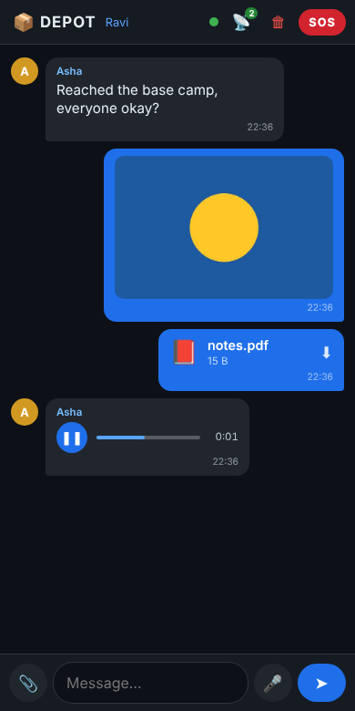
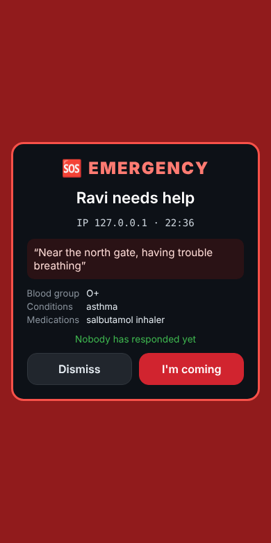
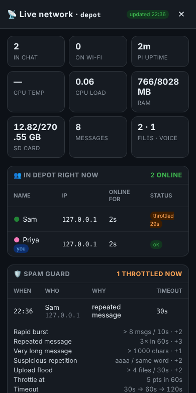
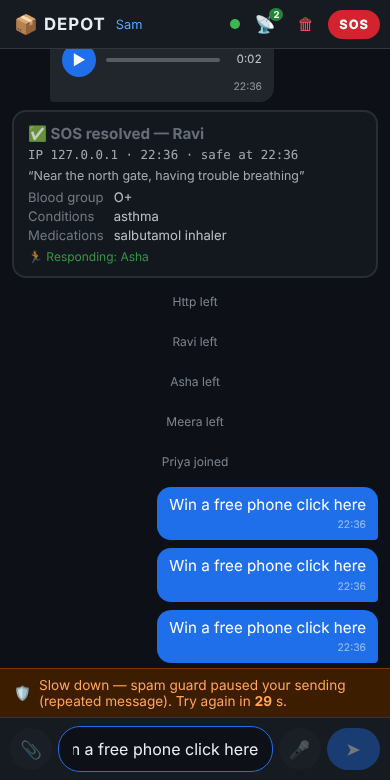

<div align="center">

# 📦 DEPOT

### Offline Communication & File-Sharing Hub — *the internet, in a backpack.*

A **Raspberry Pi** becomes the Wi-Fi network, web server, database and router,
so a group of phones can **chat, share files, send voice notes and raise an
emergency SOS** with **no internet and no mobile coverage**.


</div>

---

## What it does

Plug the Pi into a power bank. It builds its own Wi-Fi network called **`depot`**.
Anyone who joins opens **`http://10.42.0.1`** in a normal phone browser — no app,
no account — and can:

| | Feature | Summary |
|---|---|---|
| 💬 | **Real-time chat** | Messages appear on every screen instantly. History is stored on the Pi and survives reboots. |
| 📎 | **File & photo sharing** | Images preview inline; PDFs, documents and short videos download. Up to 25 MB each. |
| 🎤 | **Voice notes** | Record in the browser, send, play back with a scrubber — like WhatsApp or Telegram. |
| 📡 | **Live network monitor** | Who is connected (display name + IP), every device on the Wi-Fi, and the Pi's temperature, load, memory and SD-card use. |
| 🆘 | **Emergency SOS** | Health card captured at sign-up. One tap raises a full-screen alarm on every phone with the person's name, IP and health details. Responders tap *I'm coming*. |
| 🛡️ | **Spam guard** | Rule-based detection (bursts, repeats, floods) with escalating timeouts. SOS is never throttled. |



<table>
<tr>
<td></td>
<td></td>
<td></td>
</tr>
<tr>
<td align="center"><sub>SOS alert on every phone</sub></td>
<td align="center"><sub>Live network monitor</sub></td>
<td align="center"><sub>Spam guard countdown</sub></td>
</tr>
</table>

<sub>Screenshots are from a test run of the real server on a laptop (so the IPs read 127.0.0.1); on the Pi they show each phone's 10.42.0.x address.</sub>

---

## Quick start (use it)

1. On a phone or laptop, join Wi-Fi **`depot`** — password **`depot321`**.
2. Open **`https://10.42.0.1`** and accept the one-time certificate warning
   (*Advanced → Proceed*). HTTPS is what lets the browser use the microphone.
   Plain `http://10.42.0.1` also works, but voice notes then open the phone's own recorder.
3. Enter a display name (and, optionally, the emergency health card) and chat.

## Use cases

Disaster relief, treks and camps, college fests, classrooms without internet,
convoys and road trips, remote work sites… see **[docs/USE_CASES.md](docs/USE_CASES.md)**.

## Demonstrating it

A ready-to-run, minute-by-minute script with a pre-flight checklist and a
troubleshooting table: **[docs/DEMO_GUIDE.md](docs/DEMO_GUIDE.md)**.

## How it works

```
 [ phone ] ──┐                               ┌── [ phone ]
             │   Wi-Fi "depot" (WPA2, 2.4GHz) │
             ▼                               ▼
      ┌──────────────────────────────────────────┐
      │              Raspberry Pi 1              │
      │  hostapd  → the Wi-Fi access point       │
      │  dnsmasq  → hands out 10.42.0.50–100     │
      │  Flask    → serves the UI, port 80 / 443 │
      │  SSE      → pushes events to every phone │
      │  SQLite   → messages + profiles          │
      │  uploads/ → files and voice notes        │
      └──────────────────────────────────────────┘
```

Details, API reference and design decisions: **[docs/ARCHITECTURE.md](docs/ARCHITECTURE.md)**.

## Repository layout

```
.
├── pi/                      # Everything that runs on (or deploys to) the Raspberry Pi
│   ├── server.py            #   Flask server: chat, files, voice, SOS, network monitor, spam guard
│   ├── index.html           #   The single-page chat UI served to phones
│   ├── hostapd.conf         #   Wi-Fi access point settings
│   ├── dnsmasq-depot.conf   #   DHCP / DNS settings
│   ├── systemd/             #   3 services that start the whole network at boot
│   ├── deploy.sh            #   bash deploy helper
│   └── tools/               #   Windows helpers: deploy, rollback, health check
├── website/                 # Presentation website (React + Vite) with an "Open DEPOT" button
├── docs/                    # Use cases, demo guide, architecture, screenshots
└── LICENSE
```

## Presentation website

`website/` is a small React site that explains the project and links to the live
system. Its **Open DEPOT** button goes to `http://10.42.0.1`, and its status panel
shows live numbers from the Pi when the presenting laptop is on the `depot` Wi-Fi.

```bash
cd website
npm install
npm run dev      # http://localhost:5173
```

## Setting up a Pi

See [docs/ARCHITECTURE.md → Installing on a Pi](docs/ARCHITECTURE.md#installing-on-a-pi).
In short: copy `pi/` to `~/depot` on a Raspberry Pi OS install, create a Python
venv with `flask`, install the three unit files from `pi/systemd/`, and enable them.

## Honest limitations

* **Single hub, not a mesh.** Everyone must be within Wi-Fi range of the Pi
  (tens of metres, less through walls). If the Pi is off, the network is gone.
* **Not end-to-end encrypted.** Traffic is protected by the Wi-Fi's WPA2 password and
  (on https) a self-signed certificate; the Pi itself can read everything. The Wi-Fi
  password is deliberately simple for demos — change it for real use.
* **No accounts.** A display name is trusted as typed; the Pi identifies a device by a
  random token kept in its browser.
* **SOS tells people nearby, it does not call emergency services.** Never rely on it
  as the only way to get help.
* **Small hardware.** A Raspberry Pi 1 comfortably serves a classroom-sized group;
  uploads are capped at 25 MB and the SD card is the storage limit.

## License

MIT — see [LICENSE](LICENSE).
